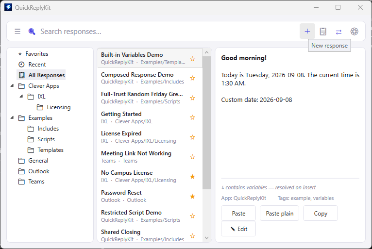
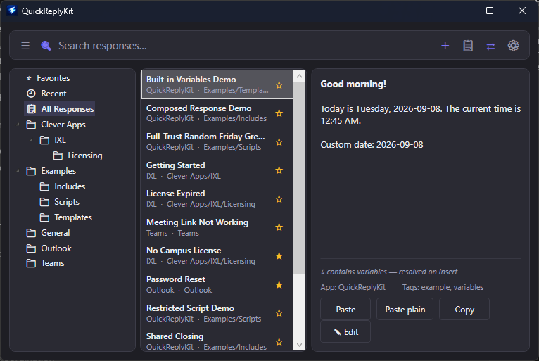
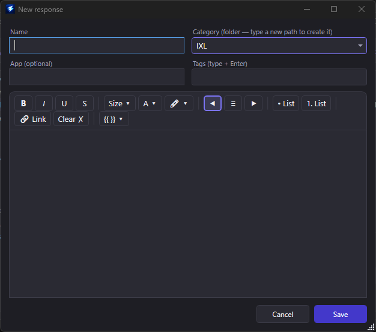
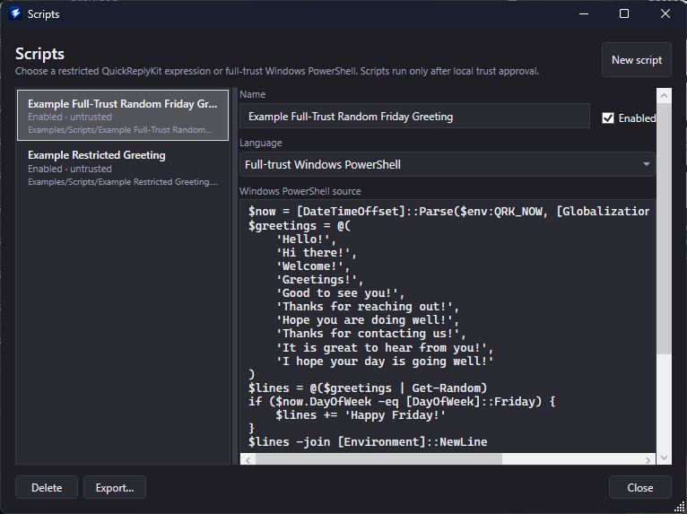
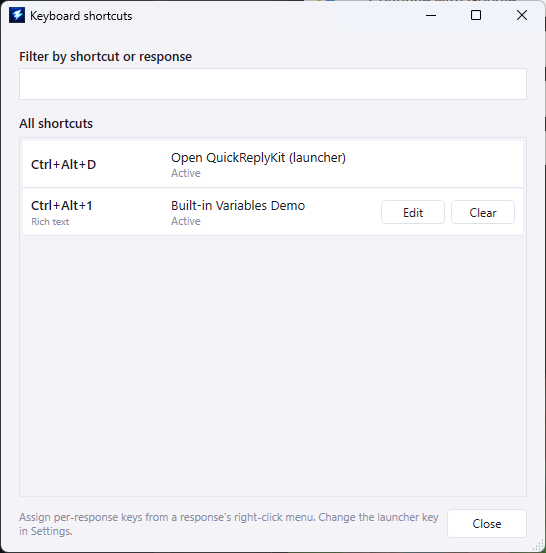
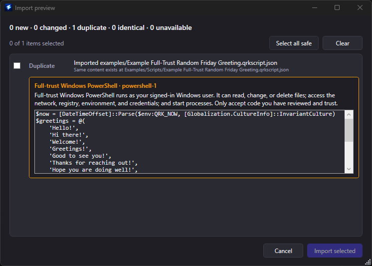
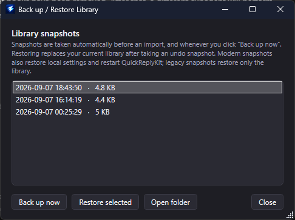
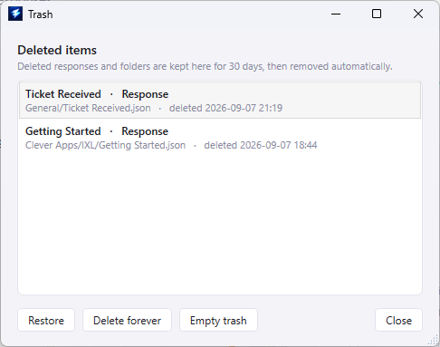
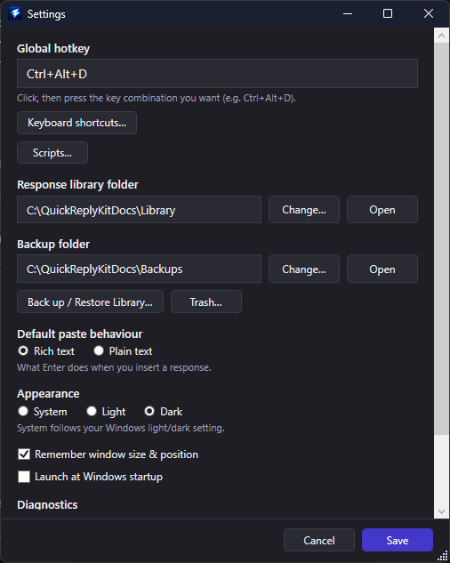
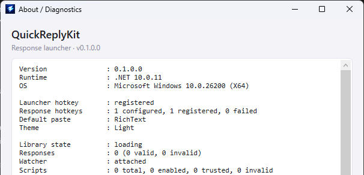

<div align="center">
  
  <h1>QuickReplyKit</h1>
  <p><strong>Find the right support response. Paste it where you are already working. Keep moving.</strong></p>
  <p>A fast, local Windows response launcher for support teams.</p>
</div>



QuickReplyKit keeps approved replies in a simple folder library. Press a global shortcut, search or browse, preview
the response, and insert it into Outlook, Teams, a browser, a CRM, or another Windows application. The launcher gets
out of the way and returns you to your work.

- **Fast:** keyboard-first launcher, background library loading, and responsive search for large libraries.
- **Local:** no account, hosted service, browser extension, CRM integration, or AI-generated content.
- **Portable:** the self-contained Windows build needs no separate .NET or Visual C++ installation.
- **Shareable:** a response is one JSON file; folders are categories and can be copied between teammates.
- **Recoverable:** rolling backups, import safety checks, and an in-app Trash protect the library.
- **Flexible:** rich text, tags, reusable sections, variables, and carefully controlled scripts.

## Quick start

### 1. Get and run the app

Use the `QuickReplyKit.exe` supplied by your administrator or project maintainer. Put it in a stable folder such as
`C:\Tools\QuickReplyKit`, then double-click it. QuickReplyKit remains available in the Windows notification area.

If you are taking a build directly from this repository, use the tracked `release` folder. Copy the entire folder contents
to a stable machine location and run `release\\QuickReplyKit.exe`.

The portable build supports **Windows 11 x64 and Microsoft-supported Windows 10 Enterprise/LTSC x64 releases**. A
clean PC does not need a separate .NET runtime, SDK, or Visual C++ Redistributable.

You can distribute either:

| Package | First-run result |
|---|---|
| `QuickReplyKit.exe` only | Starts with an empty response library. Users can create or import responses. |
| `QuickReplyKit.exe` plus `DefaultLibrary\Examples\` beside it | Seeds optional sample response patterns, but only when the user's library is empty. |

Existing libraries are never replaced by `DefaultLibrary\Examples`. To add the optional examples after an upgrade, copy the
`DefaultLibrary\Examples` folder into the configured response library.

> **Windows may show SmartScreen for an unsigned build.** Use software supplied by a source you trust. An
> organization distributing QuickReplyKit broadly should code-sign the executable.

Build and dependency details for maintainers are in [Development and distribution](docs/DEVELOPMENT.md).

### 2. Complete the first-run tour

The first launch shows three short cards covering the launcher shortcut, search, and paste workflow. QuickReplyKit
then continues running in the notification area. The tour appears once.

### 3. Make your first paste

1. Place the cursor in the destination application.
2. Press **Ctrl+Alt+D** (the configurable default launcher shortcut).
3. Type part of a response name, folder, app, tag, or message text.
4. Use **Up/Down** to select a result and review the preview.
5. Press **Enter** to use the configured paste behavior (**Rich text** by default).

QuickReplyKit hides, restores the destination app, and pastes at the existing cursor position. Common clipboard
formats from before the paste are restored. Temporary paste content is marked so Windows **should not retain it** in
clipboard history or cloud clipboard. Use **Paste plain** or **Shift+Enter** when formatting is not wanted.

## Keyboard reference

QuickReplyKit is designed so the normal workflow does not require a mouse.

| Where | Key | Action |
|---|---|---|
| Any application | **Ctrl+Alt+D** | Open the launcher. Change this in Settings. |
| Launcher search | **Up / Down** | Move through results and update the preview. |
| Launcher search | **Enter** | Insert using the configured default paste mode. |
| Launcher search | **Shift+Enter** | Insert as plain text. |
| Launcher search | **Ctrl+C** | Copy the selected response when no search text is selected. |
| Launcher | **Ctrl+F** or **Ctrl+L** | Return focus to search and select the query. |
| Empty search with a folder filter | **Backspace** | Remove the active folder scope. |
| Launcher | **Escape** | Hide QuickReplyKit and return to the prior app. |
| Lists and dialogs | **Tab / Shift+Tab**, arrows, **Enter**, **Space** | Move focus and activate standard controls. |
| Rich editor | **Ctrl+B / Ctrl+I / Ctrl+U** | Toggle bold, italic, or underline. |

Pointer users can single-click a response to select and preview it. A single click never inserts. Double-clicking a
response performs the default insert. Right-click a response or category for its management menu.

## Find and paste responses

### Browse the library

The left pane mirrors the real folder structure on disk. It also contains:

- **Favorites** for starred responses.
- **Recent** for responses pasted or intentionally copied recently.
- **All Responses** for the whole library, including visible warnings for invalid files.

Click the star beside a response to add it to or remove it from Favorites.

Select a folder to limit results to that folder and its descendants. A removable scope chip appears by search; its
label uses the selected folder's short name while the full nested path remains the actual filter. The selected folder
uses the native Windows selection background plus emphasized text, so the state is visible in Light, Dark, and High
Contrast modes. At narrow window widths the folder pane collapses automatically and can be reopened with the menu
button.

### Search

Search checks response name, app, folder path, tags, and body text. Multiple words are ANDed, so `ixl license`
requires both terms somewhere in the searchable fields. Name hits are emphasized and body-only hits show a short
matching snippet. Small typo tolerance is used only when a word has no exact match, keeping normal results
predictable. Search stays inside the selected folder, Favorites, or Recent scope until that scope is removed.

Malformed response files do not block the library. They can be found by filename in All Responses, appear with a
warning symbol and error preview, and remain non-pasteable and non-copyable.

### Preview and choose an action

The right pane renders the rich response as it will be inserted, including resolved variables and reusable response
sections. The action row provides:

- **Paste:** insert using the configured default behavior, then hide the launcher.
- **Paste plain:** strip formatting, insert text, then hide the launcher.
- **Copy:** put the resolved response on the clipboard and keep the launcher open. Because Copy is intentional, it
  replaces the clipboard normally and may appear in clipboard history.
- **Edit:** edit and save the selected library response.

Paste temporarily uses the clipboard because that is the most compatible way to preserve formatted content across
Windows applications. QuickReplyKit snapshots common formats, restores focus, writes the temporary payload, sends
paste, and restores the snapshot. If the saved destination window no longer exists, QuickReplyKit falls back to an
ordinary plain-text Copy so the response is not lost. Focus/clipboard restoration remains best-effort when another
program blocks automation, Windows denies foreground activation, or a clipboard format cannot be detached safely.



The launcher, editor, and management windows follow the System, Light, or Dark appearance selected in Settings.

## Create and organize responses

Use **+** for a blank response or the clipboard button to start from copied content. Clipboard HTML is reduced to the
supported format; active content, hidden blocks, embedded objects, and unsafe links are removed.

Right-click a response for every response-level command:

| Command | What it does |
|---|---|
| **Edit…** | Opens the saved response with name, category, app, tags, and content filled in. Saving updates the library file. |
| **Edit Response Text…** | Resolves the template, lets you change this one final message, and inserts it without saving or changing the original. |
| **Duplicate** | Creates a copy with a safe numbered name. |
| **Rename…** | Renames the response and its JSON file. |
| **Move to…** | Moves the response to an existing or new folder path. |
| **Copy** | Copies the resolved response and leaves the launcher open. |
| **Instant-paste hotkey…** | Assigns a global rich-text or plain-text shortcut to this response. |
| **Clear instant-paste hotkey** | Appears when assigned and removes that response shortcut. |
| **Open containing folder** | Selects the source file in Windows Explorer. |
| **Export response…** | Saves one portable response JSON file. |
| **Delete…** | Moves the response to QuickReplyKit Trash after confirmation. |

Right-click a category for **Export folder…** or **Delete folder…**. Folder deletion first creates a required safety
backup, then moves the entire subtree—including nested responses and side files—into Trash. The toolbar's two-arrow
menu provides **Import responses…** and **Export full library…**.

### Folders and shared libraries

Folders are categories; subfolders create deeper categories. For example:

```text
Clever Apps
└── IXL
    └── Licensing
        └── No Campus License.json
```

The app watches the library and recognizes added, changed, moved, and removed files without being rebuilt or
restarted. A teammate can share one response, a category, or a larger library by copying files/folders into your
library. Empty folders are valid.

### Response tags

In the editor, type a tag and press **Enter**, comma, or **Tab**. Each tag becomes a colored chip below the field;
use its **×** button to remove it. When the tag field is empty, **Backspace** removes the last chip. Tags are stored
with the response, travel when it is shared, and are included in search. Duplicates are ignored case-insensitively.

QuickReplyKit does not apply tags to folders. Older `.qrkfolder.json` sidecar files are safely ignored.

## Rich-text editor



The focused editor supports the formatting normally needed in support communication:

- bold, italic, underline, and strikethrough;
- small, normal, large, and heading text;
- standard text and highlight color palettes;
- left, center, and right paragraph alignment;
- bulleted and numbered lists;
- hyperlinks, paragraphs, and line breaks;
- clear formatting;
- built-in variable insertion.

Choose a response name, optional app, tags, and destination category. The Category field accepts an existing folder
from the dropdown or a new nested path such as `Clever Apps/IXL/Licensing`; missing folders are created on Save.

**New from clipboard** prefers cleaned rich text when available and falls back to encoded plain text. **Edit Response
Text…** uses the same editor in transient compose mode: library metadata is hidden and the bottom actions become
Insert / Insert plain instead of Save.

## Templates, variables, and reusable sections

QuickReplyKit resolves `{{...}}` tokens in previews, paste, plain paste, copy, one-off editing, and instant hotkeys.
The saved source remains unchanged.

### Built-in variables

| Token | Result |
|---|---|
| `{{greeting}}` | `Good morning`, `Good afternoon`, or `Good evening` based on local time. |
| `{{date}}` | Current short date using Windows regional settings. |
| `{{time}}` | Current short time using Windows regional settings. |
| `{{day}}` | Current day name. |
| `{{date:yyyy-MM-dd}}` | Current date using the supplied .NET date format. |

Insert common tokens from the editor's **`{{ }}`** menu.

### Include another response

Use another response's name as a token to reuse approved sections:

```text
{{Shared Welcome}}

Main response content.

{{Shared Closing}}
```

Includes can be nested. Missing references, ambiguity, and cycles produce visible markers rather than freezing the
launcher. Keep response names unique across the library for predictable includes.

### Restricted expressions

`{{script:Name}}` calls an enabled, locally trusted script definition. The recommended `qrk-expr-1` language is a
small expression evaluator for bounded text/date logic. It supports literals, clock values, comparisons, Boolean
operators, and pure functions such as `if`, `concat`, `upper`, `lower`, `date`, and `time`.

It cannot access files, processes, the network, environment variables, registry, clipboard, UI, reflection, or
native code. Invalid, missing, disabled, changed, ambiguous, or untrusted definitions fail closed with a marker.

### Full-trust Windows PowerShell

> **Full-trust PowerShell is not sandboxed.** A trusted `powershell-1` definition runs as the same Windows account
> and privilege level as QuickReplyKit
> and can read, change, or delete files; access the network, registry, environment, credentials, and processes; and
> start programs. Review every line and trust only code from a source you fully understand.

Full-trust definitions require the inbox **Windows PowerShell** executable. QuickReplyKit runs approved source out of
process, without a profile or visible console, and applies source, output, time, cancellation, and concurrency limits.
Those limits protect app responsiveness; they do not remove the script's Windows permissions.

If a response references a missing, disabled, untrusted, blocked, or failed script, QuickReplyKit does not paste or
copy the error marker. Launcher actions show a clear error dialog; instant-paste hotkeys show a tray notification.
PowerShell source and raw error output are never written to diagnostics logs. When a resolved preview is already on
screen, Paste reuses that exact result, avoiding a second PowerShell startup and ensuring the pasted text matches the
preview.

Open **Settings > Scripts…** to create, validate, enable, inspect, trust, export, or delete definitions. New scripts
default to the restricted language. Trust is local and tied to the exact language and source; editing either revokes
trust. Trust is never stored in exported definitions.



The optional Examples folder demonstrates built-ins, includes, a restricted expression, and a clearly labeled
PowerShell greeting that randomly chooses from ten phrases and adds a separate Friday line. Additional inert examples
show a next-business-day date, business-hours status, random professional closing, and case-note timestamp. Full-trust
examples remain disabled or untrusted until each exact source is reviewed and explicitly approved.

## Instant per-response hotkeys

An instant-paste hotkey inserts one response into the active application **without opening the launcher**.

1. Right-click a valid response and choose **Instant-paste hotkey…**.
2. Focus the capture box and press a modifier-plus-key combination such as `Ctrl+Alt+1`.
3. Choose **Rich text** or **Plain text**, then Save.

Open **Settings > Keyboard shortcuts…** to review every registration. The manager shows the launcher shortcut and
all response shortcuts, filters by shortcut or response name, and labels duplicate combinations or shortcuts already
in use by another application. Use Edit to reassign a response shortcut or Clear to remove it.



Response hotkeys are local settings keyed by the response's relative path. They do not travel with shared response
files. If a response is moved, renamed, deleted, or unavailable, the manager reports that the target was not found.

## Import and export

Open the **Import / Export** toolbar menu (two-arrow icon) to import responses/scripts or export the full library.
Use a response context menu to export one JSON file, or a category context menu to export that folder as a ZIP.

### Import review

Import accepts a response JSON file or ZIP library. Before writing anything, QuickReplyKit builds one review plan and
classifies each entry as **New**, **Changed**, **Duplicate**, **Identical**, **Invalid**, or **Unsafe**.

- New/Changed/Duplicate ordinary responses have explicit checkboxes.
- **Select all safe** selects ordinary eligible files; **Clear** clears those selections.
- Each selected conflict uses its own **Overwrite** or safer **Keep both** choice.
- Identical, Invalid, and Unsafe rows are disabled and remain Skip.
- A required rolling backup is created after review acceptance and before any write.
- Source and destination fingerprints are rechecked; an entry changed after preview is reported **Stale** instead of
  being overwritten.

Script definitions always require separate review. Their language and exact source are shown, every row starts
unchecked, and each item must be accepted individually. **Select all safe never accepts code.** There is no Yes to
all for code-bearing items. Full-trust PowerShell displays an additional Windows-permission warning. Accepted code is
trusted only after the exact destination is successfully written, reloaded, and byte-verified.



Invalid, unsafe, stale, or failed entries do not prevent valid siblings from importing. The completion dialog reports
imported, overwritten, kept-as-copy, skipped, invalid/unsafe, stale, and failed counts.

## Protect and recover the library

### Rolling backups

Open **Settings > Back up / Restore Library…** to create a snapshot, restore the selected snapshot, or open the
configured folder. QuickReplyKit also requires a backup before imports and category-folder deletion.

A current snapshot contains the response library and app settings; older library-only backups remain supported.
Restore protects the selected archive, validates and size-bounds extraction, snapshots the current state, stages the
replacement, and rolls the exact original library back if installation fails. The app restarts after restored settings
are applied.

Retention keeps **up to 10 snapshots**, subject to **500 MB total** and **90-day** limits while preserving at least the
newest. The backup folder can be a writable local or network path outside the library. If unavailable, QuickReplyKit
still launches but safely refuses the affected backup, restore, import, or folder-delete operation.

### Trash

Delete moves responses and complete categories into Trash instead of erasing them immediately. Open **Settings >
Trash…** to restore an item to its exact path, delete one permanently, or empty Trash.

Restore never overwrites an existing file/folder and keeps the Trash copy on conflict or unsafe path. Items are kept
for **30 days by default**; retention 0 keeps them until manually removed.

<table>
  <tr>
    <td></td>
    <td></td>
  </tr>
  <tr>
    <td align="center"><em>Rolling snapshots</em></td>
    <td align="center"><em>Recoverable deletion</em></td>
  </tr>
</table>

## Settings and desktop integration

Open Settings from the launcher's gear button or tray menu. Closing the launcher hides it while QuickReplyKit remains
available in the notification area; choose **Exit** from the tray menu to stop the application.



Defaults are **Ctrl+Alt+D**, **Rich text**, **System** appearance, **Remember window** on, and **Verbose logging** off.

| Setting or tool | Purpose |
|---|---|
| **Global hotkey** | Change the launcher shortcut. Invalid or occupied combinations are reported safely. |
| **Keyboard shortcuts…** | Review launcher/instant-paste registrations and conflicts. |
| **Scripts…** | Manage restricted-expression and full-trust PowerShell definitions. |
| **Response library folder** | Change or open the watched library location. |
| **Backup folder** | Change or open the rolling-snapshot location. |
| **Back up / Restore Library…** | Create and restore snapshots. |
| **Trash…** | Restore or permanently remove deleted responses/categories. |
| **Default paste behavior** | Choose Rich text or Plain text for Enter/Paste. |
| **Appearance** | Follow Windows (System) or force Light/Dark; Cancel reverts the live preview. |
| **Remember window size & position** | Restore useful visible bounds after monitor changes. |
| **Launch at Windows startup** | Register QuickReplyKit for the current Windows user. |
| **Verbose logging** | Add bounded troubleshooting counts/timings without response/customer content. |
| **About / Diagnostics…** | Show version, environment, registration counts, state, and support locations. |

The tray menu provides **Open QuickReplyKit**, **Open Response Library**, **Import…**, **Export library…**,
**Settings**, **Open logs folder**, and **Exit**. Double-click the tray icon to open the launcher. Only one app instance
runs; starting the EXE again asks the existing instance to show itself.

## Diagnostics, logs, and support



When reporting a problem:

1. Open **Settings > About / Diagnostics…**.
2. Use **Copy** to copy the support summary.
3. Use **Open logs folder** and include the current session log if your support policy permits it.
4. Describe the failed action and approximate time.

Logs roll at roughly 10 MB per file and five files (about 50 MB total). Normal logging records lifecycle and safe
workflow stages; verbose adds bounded counts/timings. Logs exclude search text, response names/tags/content, template
token names, clipboard data, hotkey values, window handles, user paths, and exception messages. The copied diagnostic
report includes resolved support paths but excludes response content, individual response hotkeys, script source, and
clipboard/customer data. Review files under your organization's support/privacy policy before sharing.

## Storage and privacy

QuickReplyKit requires no account and sends no library data to a QuickReplyKit service. Normal operation is local.
Full-trust PowerShell can access external resources with the signed-in user's permissions, which is why exact-source
local trust is mandatory.

| Data | Default location | Travels with copied responses? |
|---|---|---|
| Response library | `%USERPROFILE%\Documents\QuickReplyKit\Library` | Yes—when its JSON files/folders are copied. |
| Backups | `%USERPROFILE%\Documents\QuickReplyKit\Backups` | No, unless a snapshot is deliberately shared. |
| Settings/hotkeys | `%APPDATA%\QuickReplyKit\config.json` | No. |
| Recent | `%APPDATA%\QuickReplyKit\recent.json` | No. |
| Logs | `%APPDATA%\QuickReplyKit\logs` | No. |
| Trash | `%APPDATA%\QuickReplyKit\trash` | No. |
| Script trust | `%APPDATA%\QuickReplyKit\script-trust.json` | **Never.** Trust is local/source-bound. |

Favorites are stored in response files, so they travel when those files are shared. Library/backup paths are
configurable.

## Accessibility

- Complete launcher workflow is keyboard-operable.
- Controls and collection rows expose screen-reader names, help text, and live status where appropriate.
- Keyboard focus remains visible even where pointer hover is deliberately minimal.
- Selected folders and warning/error states use text, weight, or symbols in addition to color.
- Light, Dark, Windows High Contrast, and per-monitor DPI changes are supported.
- Long paths, shortcuts, and response names expose full-value tooltips when clipped.
- Dialogs scroll/resize so actions remain reachable on compact or high-scale displays.

For a screen-reader issue, include the Windows version, scaling, assistive technology/version, and affected window in
the support report.

## Troubleshooting

### Ctrl+Alt+D does not open QuickReplyKit

- Confirm the tray icon is present and open the launcher from its menu.
- Open **Settings > Keyboard shortcuts…** and check the launcher row.
- Another app may own the combination. Choose another global hotkey and Save.
- If the app is not running, start `QuickReplyKit.exe` again.

### An instant hotkey does nothing

- Check Keyboard Shortcuts for **Duplicate**, **In use by another app**, or **not found**.
- Confirm the response remains at the same library-relative path, then reassign if needed.
- A slow full-trust script may return a timeout marker instead of pasting.

### Paste goes to the wrong place or does not insert

- Click the destination field before opening QuickReplyKit.
- Try **Paste plain** to separate formatting restrictions from focus problems.
- Elevated, secure, full-screen, remote-session, or automation-resistant apps may deny focus/input.
- Use **Copy** as a fallback, paste manually, and collect the log after reproducing the issue.

### Formatting changes after paste

- The destination decides how clipboard HTML maps into its editor. Use Paste plain when rich text is unsupported.
- Highlight colors are absolute. Highlighted text with Automatic color can have lower contrast between light/dark
  editors; choose an explicit text color when needed.

### A response is missing

- Clear folder/Favorites/Recent scope and search All Responses.
- Check Trash, then open the library folder and confirm the JSON file exists.
- Invalid files remain visible by filename with a warning instead of disappearing silently.

### Import or folder deletion is canceled

- The required backup could not be written. Check backup-folder access and free space, then retry.
- Review disabled Invalid/Unsafe rows and Stale outcomes instead of forcing the operation.

### A script shows a marker instead of text

- In Scripts, check that the definition is valid, enabled, unique, and trusted for its exact source.
- Editing source/language revokes trust by design. Never bypass review for unfamiliar code.
- Full-trust scripts also require inbox Windows PowerShell to be available.

### The EXE will not start on another computer

- Use the **win-x64 self-contained single-file** publish, not a framework-dependent development output.
- Confirm supported x64 Windows and that security software has not quarantined the unsigned executable.
- The portable build is approximately **70 MB (about 66.7 MiB)** and needs no separate .NET/VC++ installation.

## Known limits

- Windows-only: Windows 11 x64 and Microsoft-supported Windows 10 Enterprise/LTSC x64 releases.
- The executable is unsigned, so SmartScreen or organizational controls may prompt or block it.
- Rich rendering depends on the destination application's clipboard support.
- Focus and common-format clipboard restoration are best-effort across privilege, app, and remote-session boundaries.
- A same-user malicious process can modify another app's local files, including the trust ledger; this is outside the
  application-level trust boundary.
- QuickReplyKit intentionally excludes CRM integrations, browser extensions, page scraping, ticket automation, and
  AI-generated responses.

## Development and license

Maintainers: see [Development and distribution](docs/DEVELOPMENT.md), [Architecture](ARCHITECTURE.md), and
[current status](docs/STATUS.md). Original requirements are preserved in [Project brief](docs/PROJECT-BRIEF.md).

QuickReplyKit is available under the [MIT License](LICENSE).
